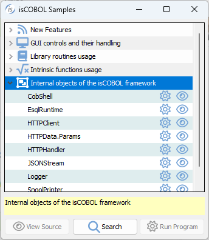

# Internal Objects

isCOBOL includes the following internal objects:

|  |
| --- |
| [CallHandler Interface (com.iscobol.rts.CallHandler)](./CallHanlder-Interface/CallHandler-Interface) |
| [CobolGUIJavaBean Class (com.iscobol.gui.server.CobolGUIJavaBean)](./CobolGUIJavaBean-Class/CobolGUIJavaBean-Class) |
| [CobShell Class (com.iscobol.cobshell.CobShell)](./CobShell-Class/CobShell-Class) |
| [CurrentDate Class (com.iscobol.rts.CurrentDate)](./CurrentDate-Class) |
| [efdParser Class (com.iscobol.lib.efdParser)](./efdParser-Class/efdParser-Class) |
| [EsqlRuntime (com.iscobol.rts.EsqlRuntime)](./EsqlRuntime/EsqlRuntime) |
| [HTTPClient, HTTPData.params and HTTPHandler Classes](./HTTPClient-HTTPData.params-and-HTTPHandler-Classes) |
| [JSONStream Class (com.iscobol.rts.JSONStream)](./JSONStream-Class/JSONStream-Class) |
| [Logger Class (com.iscobol.logger.Logger)](./Logger-Class/Logger-Class) |
| [LoggerFactory Class (com.iscobol.logger.LoggerFactory)](./LoggerFactory-Class/LoggerFactory-Class) |
| [MapCallException (com.iscobol.rts.MapCallException)](./MapCallException/MapCallException) |
| [Slf4jLogger Class (com.iscobol.logger.Slf4jLogger)](./Slf4jLogger-Class) |
| [SearchPanelSettings Class (com.iscobol.gui.server.SearchPanelSettings)](./SearchPanelSettings-Class) |
| [SpoolPrinter Class (com.iscobol.rts.print.SpoolPrinter) and the Print Preview](./SpoolPrinter-Class-and-the-Print-Preview) |
| [StoreProcedure Class (com.iscobol.lib.StoreProcedure)](./StoreProcedure-Class/StoreProcedure-Class) |
| [WindowCreateHandler Interface (com.iscobol.rts.WindowCreateHandler)](./WindowCreateHandler-Interface) |
| [XMLStream Class (com.iscobol.rts.XMLStream)](./XMLStream-Class/XMLStream-Class) |

Sample programs for most of the above objects are available among the isCOBOL Samples.

