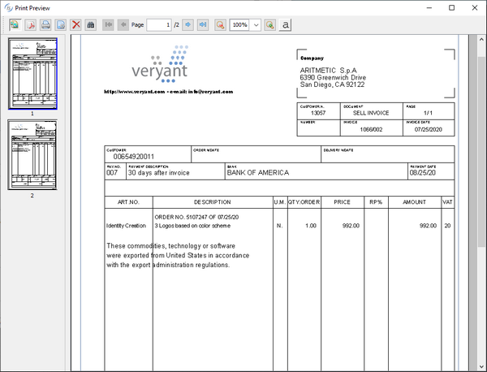

## SpoolPrinter Class (com.iscobol.rts.print.SpoolPrinter) and the Print Preview

The isCOBOL Framework provides the ability to obtain a print preview.

This feature is applicable to all print files. In order to obtain a print preview you need to define the file as follows:

```cobol
SELECT print-prev ASSIGN TO PRINT "-P PREVIEW"
       ORGANIZATION LINE SEQUENTIAL.
```



The preview dialog will show up when the print file is closed.

The tool-bar on top of the dialog allows you to:

- show or hide page preview thumbnails
- save the job as PDF file
- print the job with a physical printer
- close the dialog
- find text (available also by pressing CTRL+F)
- navigate through pages (if the job contains more than one page)
- zoom in and out for better reading
- apply aliasing on the text for better reading

The dialog title can be set through the configuration property [iscobol.print.preview.title](../../SDK-Users-Guide/Compiler-and-Runtime/Configuration/Configuration-Properties).

The dialog icon can be changed through the configuration  property [iscobol.print.preview.icon](../../SDK-Users-Guide/Compiler-and-Runtime/Configuration/Configuration-Properties).

### The com.iscobol.rts.print.SpoolPrinter class

The print preview dialog can be customized by calling methods of the internal factory class com.iscobol.rts.print.SpoolPrinter. These methods must be called before the print file is closed. The following table shows the javadoc of the existing methods.

|  |  |
| --- | --- |
| static String | **getDialogTitle**()<br>Returns the title of the preview window |
| static javax.swing.ImageIcon | **getImageIcon**()<br>Returns the current icon shown in the preview dialog title bar |
| static java.awt.Point | **getPreviewLocation**()<br>Returns the location in pixels of the preview dialog |
| static double | **getPreviewScale**()<br>Returns the current scale.<br>Positive values from 1 to 100 indicate the zoom percentage.<br>The negative value -1 indicates "fit width".<br>The negative value -2 indicates "fit page" |
| static java.awt.Dimension | **getPreviewSize**()<br>Returns the size in pixels of the preview dialog |
| static java.awt.Color | **getPrintableAreaBoxColor**()<br>Returns the color of the frame in which the preview is displayed |
| static String | **getSaveDefaultDirectory**()<br>Returns the directory proposed by the Save As dialog |
| static String | **getSaveDefaultFilename**()<br>Returns the file name proposed by the Save As dialog |
| static boolean | **isCloseWindowAfterPrint**()<br>Returns whether the preview dialog will close automatically after the document has been printed |
| static boolean | **isCloseWindowAfterPrintPdf**()<br>Returns whether the preview dialog will close automatically after the document has been saved to PDF |
| static boolean | **isPreviewAliasing**()<br>Returns the status of the Aliasing button |
| static boolean | **isPreviewMaximized**()<br>Returns whether the preview dialog is maximized |
| static boolean | **isShowExportMenu**()<br>Returns whether the Export menu is visible (IDE reports only) |
| static boolean | **isShowPrintButton**()<br>Returns whether the Print button is visible or not in the tool-bar |
| static boolean | **isShowPrintDialog**()<br>Returns whether the *Printer Setup* dialog must be shown before printing |
| static boolean | **isShowPrintSetupButton**()<br>Returns whether the Print Setup button is visible or not in the tool-bar |
| static boolean | **isShowSaveButton**()<br>Returns whether the Save button is visible or not in the tool-bar |
| static boolean | **isShowThumbnailsButton**()<br>Returns whether the Thumbnails button is visible or not in the tool-bar |
| static void | **setCloseWindowAfterPrint**(boolean *close*)<br>Specifies if the preview window will close automatically after the the document has been printed |
| static  void | **setCloseWindowAfterPrintPdf**(boolean *close*)<br>Specifies if the preview window will close automatically the document has been saved to PDF |
| static void | **setDialogTitle**(String *title*)<br>Sets the title of the preview window |
| static void | **setImageIcon**(javax.swing.ImageIcon *icon*)<br>Sets the icon to show in the preview dialog title bar |
| static void | **setPreviewAliasing**(boolean *aliasing*)<br>Sets the status of the Aliasing button |
| static void | **setPreviewLocation**(int *x*, int *y*)<br>Sets the location in pixels of the preview dialog |
| static void | **setPreviewMaximized**(boolean *maximize*)<br>Choose if the preview dialog must be maximized or not |
| static void | **setPreviewMaximized**(boolean *maximize*)<br>Choose if the preview dialog must be maximized or not |
| static void | **setPreviewScale**(double *scale*)<br>Sets the current scale.<br>Positive values from 1 to 100 indicate the zoom percentage.<br>The negative value -1 indicates "fit width".<br>The negative value -2 indicates "fit page" |
| static void | **setPreviewSize**(int *width*, int *height*)<br>Sets the size in pixels for the print preview dialog |
| static void | **setPrintableAreaBoxColor**(java.awt.Color *color*)<br>Sets the color of the frame in which the preview is displayed |
| static void | **setSaveDefaultDirectory**(String *path*)<br>Sets the directory proposed by the Save As dialog |
| static void | **setSaveDefaultFilename**(String *name*)<br>Sets the file name proposed by the Save As dialog.<br>Note - If the selected filename has no extension, then the ".pdf" extension is automatically added. |
| static void | **setShowExportMenu**(boolean *showExportMenu*)<br>Sets the visibility of the the Export menu (IDE reports only) |
| static void | **setShowPrintButton**(boolean *showPrintButton*)<br>Sets the visibility of the Print button in the tool-bar |
| static void | **setShowPrintDialog**(boolean *showPrintDialog*)<br>Choose if the *Printer Setup* dialog must be shown before printing |
| static void | **setShowPrintSetupButton**(boolean *showPrintSetupButton*)<br>Sets the visibility of the Print Setup button in the tool-bar |
| static void | **setShowSaveButton**(boolean *showSaveButton*)<br>Sets the visibility of the Save button in the tool-bar |
| static void | **setShowThumbnailsButton**(boolean *showThumbnailsButton*)<br>Sets the visibility of the Thumbnails button in the tool-bar |

**Note** - The com.iscobol.rts.print.SpoolPrinter class affects also Reports generated by the IDE.

The following sample shows how to make the preview dialog appear with the zoom set to 50%:

```cobol
CONFIGURATION SECTION.
REPOSITORY.
    class is-spoolprinter as "com.iscobol.rts.print.SpoolPrinter"
              .
INPUT-OUTPUT SECTION.
FILE-CONTROL.
    select print-job assign to printer "-P PREVIEW"
           organization line sequential.

FILE SECTION.
FD  print-job.
01  print-record pic x(83).

PROCEDURE DIVISION.
main.
    open output print-job.
    write print-record from "test zoom".
    is-spoolprinter:>setPreviewScale(50 as double).
    close print-job.
    goback.
```

#### Thin Client

In a Thin Client environment, print jobs are managed client side so the print preview dialog must be configured and invoked client side. In order to invoke com.iscobol.rts.print.SpoolPrinter methods client side, you can use the [CobolGUIJavaBean Class (com.iscobol.gui.server.CobolGUIJavaBean)](./CobolGUIJavaBean-Class/CobolGUIJavaBean-Class).

The following sample shows how to make the preview dialog appear client side with the zoom set to 50%:

```cobol
CONFIGURATION SECTION.
REPOSITORY.
    class is-java-bean as "com.iscobol.gui.server.CobolGUIJavaBean"
    class j-double     as "java.lang.Double"
              .
INPUT-OUTPUT SECTION.
FILE-CONTROL.
    select print-job assign to printer "-P PREVIEW"
           organization line sequential.

FILE SECTION.
FD  print-job.
01  print-record pic x(83).

PROCEDURE DIVISION.
main.
    open output print-job.
    write print-record from "test zoom".
    is-java-bean:>callStaticMethod("com.iscobol.rts.print.SpoolPrinter", "setPreviewScale", j-double:>new(50 as double)).
    close print-job.
    goback.
```

**Note -** The com.iscobol.preview.PreviewDialogSettings JavaBean has been deprecated. It’s still supported for backward compatibility but it lacks the latest methods implemented in com.iscobol.rts.print.SpoolPrinter.
