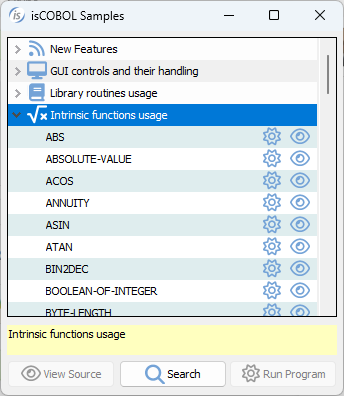

# Intrinsic Functions

Intrinsic functions are temporary data item whose value is determined at the time the function is referenced during the execution of a statement.

The table below shows all available intrinsic functions.

The **Function name** column defines the name of the function.

The **Function type** column defines the type of the function, it can be: Integer, Numeric, Alphabetic, Alphanumeric. When "any" word appears it means that the type of the function depends on the argument type.

The **Argument number** column defines the number of the arguments. When "arbitrary" word appears it means that the number or arguments is undefined and it can be arbitrary. When 0 appears, it means that the function doesn't has arguments.

The **Argument type** column defines the type of the arguments, they can be: Integer, Numeric, Alphabetic, Alphanumeric. When "any" appears it means that the type of the argument can be any of theme.

A detailed documentation of each single function follows.

| Function name | Function type | Argument number | Argument type | Description |
| --- | --- | --- | --- | --- |
| [ABS](./ABS) | Numeric | 1 | Numeric | Absolute value of the argument passed |
| [ABSOLUTE-VALUE](./ABSOLUTE-VALUE) | Numeric | 1 | Numeric | Absolute value of the argument passed |
| [ACOS](./ACOS) | Numeric | 1 | Numeric | Arccosine of argument |
| [ANNUITY](./ANNUITY) | Numeric | 2 | Numeric | Annuity of the arguments |
| [ASIN](./ASIN) | Numeric | 1 | Numeric | Arcsine of argument |
| [ATAN](./ATAN) | Numeric | 1 | Numeric | Arctangent of argument |
| [BIN2DEC](./BIN2DEC) | Numeric | 1 | Alphanumeric | Decimal representation of binary data |
| [BIT-OF](./BIT-OF) | Any | 1 | Alphanumeric | Bit pattern corresponding to the binary value of argument |
| [BIT-TO-CHAR](./BIT-TO-CHAR) | Alphanumeric | 1 | Alphanumeric | Character string corresponding to the bit pattern indicated by argument |
| [BOOLEAN-OF-INTEGER](./BOOLEAN-OF-INTEGER) | Boolean | 2 | Numeric | Boolean representation of the argument |
| [BYTE-LENGTH](./BYTE-LENGTH) | Numeric | 1 | any | Length of argument in number of bytes |
| [CAPACITY](./CAPACITY) | Numeric | 1 | Occurs | Current capacity of a dynamic capacity table |
| [CHAR](./CHAR) | Alphanumeric | 1 | Integer | Character in position of argument |
| [COMPILED-INFO](./COMPILED-INFO) | Alphanumeric | 0 |  | Compiler build number, compile flags and compile date |
| [COS](./COS) | Numeric | 1 | Numeric | Cosine of argument |
| [CURRENT-DATE](./CURRENT-DATE) | Alphanumeric | 0 |  | Current date and time and difference from Greenwich Mean Time |
| [DATE-OF-INTEGER](./DATE-OF-INTEGER) | Integer | 1 | Integer | Standard date equivalent (YYYYMMDD) of integer date |
| [DATE-TO-YYYYMMDD](./DATE-TO-YYYYMMDD) | Integer | 2 | Integer | Date with four digits year of a date with two digits year. The second optional parameter is the threshold (default 50) |
| [DAY-OF-INTEGER](./DAY-OF-INTEGER) | Integer | 1 | Integer | Julian date equivalent (YYYYDDD) of integer date |
| [DAY-TO-YYYYMMDD](./DAY-TO-YYYYMMDD) | Integer | 2 | Integer | Date with four digits year of a date with two digits year. in the format *YYddd* The second optional parameter is the threshold (default 50) |
| [DEC2BIN](./DEC2BIN) | Alphanumeric | 1 | Numeric | Binary representation of decimal data |
| [DEC2HEX](./DEC2HEX) | Alphanumeric | 1 | Numeric | Hexadecimal representation of decimal data |
| [DEC2OCT](./DEC2OCT) | Alphanumeric | 1 | Numeric | Octal representation of decimal data |
| [DISPLAY-OF](./DISPLAY-OF) | Alphanumeric | 2 | National | Character representation of a national value |
| [E](./E) | Numeric | 0 |  | The value of E, the natural base |
| [EXP](./EXP) | Numeric | 1 | Numeric | E raised to the power of argument |
| [EXP10](./EXP10) | Numeric | 1 | Numeric | E raised to the power of argument |
| [FACTORIAL](./FACTORIAL) | Integer | 1 | Integer | Factorial of argument |
| [FRACTION-PART](./FRACTION-PART) | Numeric | 1 | Numeric | Fraction part of argument |
| [HANDLE-TYPE](./HANDLE-TYPE) | Integer | 1 | Integer | resource identified by the handle |
| [HEX2DEC](./HEX2DEC) | Numeric | 1 | Alphanumeric | Decimal representation of hexadecimal data |
| [HEX-OF](./HEX-OF) | Any | 1 | Alphanumeric | Bytes of argument converted to a hexadecimal representation |
| [HEX-TO-CHAR](./HEX-TO-CHAR) | Alphanumeric | 1 | Alphanumeric | Character string corresponding to the hexadecimal digit characters in argument |
| [INTEGER](./INTEGER) | Integer | 1 | Numeric | The greatest integer not greater than argument |
| [INTEGER-OF-BOOLEAN](./INTEGER-OF-BOOLEAN) | Integer | 1 | Boolean | Integer representation of a boolean value |
| [INTEGER-OF-DATE](./INTEGER-OF-DATE) | Integer | 1 | Integer | Integer date equivalent of standard date (YYYYMMDD) |
| [INTEGER-OF-DAY](./INTEGER-OF-DAY) | Integer | 1 | Integer | Integer date equivalent of Julian date (YYYYDDD) |
| [INTEGER-PART](./INTEGER-PART) | Integer | 1 | Numeric | Integer part of argument |
| [LENGTH](./LENGTH) | Integer | 1 | any | Length of argument |
| [LOG](./LOG) | Numeric | 1 | Numeric | Natural logarithm of argument |
| [LOG10](./LOG10) | Numeric | 1 | Numeric | Logarithm to base 10 of argument |
| [LOWER-CASE](./LOWER-CASE) | Alphanumeric | 1 | Alphanumeric | All letters in the argument are set to lowercase |
| [MAX](./MAX) | any | arbitrary | any | Value of maximum argument |
| [MEAN](./MEAN) | Numeric | arbitrary | Numeric | Arithmetic mean of arguments |
| [MEDIAN](./MEDIAN) | Numeric | arbitrary | Numeric | Median of arguments |
| [MIDRANGE](./MIDRANGE) | Numeric | arbitrary | Numeric | Mean of minimum and maximum arguments |
| [MIN](./MIN) | any | arbitrary | any | Value of minimum argument |
| [MOD](./MOD) | Integer | 2 | Integer | argument 1 modulo argument 2 |
| [NATIONAL-OF](./NATIONAL-OF) | National | 2 | Alphanumeric | National representation of a character string |
| [NUMVAL](./NUMVAL) | Numeric | 1 | Alphanumeric | Numeric value of simple numeric string |
| [NUMVAL-C](./NUMVAL-C) | Numeric | 2 | Alphanumeric | Numeric value of numeric string with optional commas and currency sign |
| [NUMVAL-F](./NUMVAL-F) | Numeric | 1 | Alphanumeric | Numeric value of numeric string with optional exponent value |
| [OCT2DEC](./OCT2DEC) | Numeric | 1 | Numeric | Decimal representation of octal data |
| [ORD](./ORD) | Integer | 1 | Alphanumeric | Ordinal position of the argument in collating sequence |
| [ORD-MAX](./ORD-MAX) | Integer | 1 | any | Ordinal position of maximum argument |
| [ORD-MIN](./ORD-MIN) | Integer | 1 | any | Ordinal position of minimum argument |
| [PI](./PI) | Numeric | 0 |  | Value of π |
| [PRESENT-VALUE](./PRESENT-VALUE) | Numeric | 2 | Numeric | Present value of a series of future period-end amounts, argument 2 at a discount rate of argument 1 |
| [RANDOM](./RANDOM) | Numeric | 1 | Integer | Random number between 0 and 1 |
| [RANGE](./RANGE) | Numeric | arbitrary | Numeric | Value of maximum argument minus value of minimum argument |
| [REM](./REM) | Numeric | 2 | Numeric | Remainder of arg 1 / arg 2 |
| [REVERSE](./REVERSE) | Alphanumeric | 1 | Alphanumeric | Reverse order of the characters of the argument |
| [SIGN](./SIGN) | Numeric | 1 | Numeric | 1 if argument is positive 0 if argument is zero -1 if argument is negative |
| [SIN](./SIN) | Numeric | 1 | Numeric | Sine of argument |
| [SQRT](./SQRT) | Numeric | 1 | Numeric | Square root of argument |
| [STANDARD-DEVIATION](./STANDARD-DEVIATION) | Numeric | arbitrary | Numeric | Standard deviation of arguments |
| [SUM](./SUM) | Numeric | arbitrary | Numeric | Sum of arguments |
| [TAN](./TAN) | Numeric | 1 | Numeric | Tangent of argument |
| [TEST-NUMVAL](./TEST-NUMVAL) | Numeric | 1 | Alphanumeric | Conformance of argument for the NUMVAL function |
| [TEST-NUMVAL-C](./TEST-NUMVAL-C) | Numeric | 1 | Alphanumeric | Conformance of argument for the NUMVAL-C function |
| [TEST-NUMVAL-F](./TEST-NUMVAL-F) | Numeric | 1 | Alphanumeric | Conformance of argument for the NUMVAL-F function |
| [TRIM](./TRIM) | Alphanumeric | 1 | Alphanumeric | The argument is trimmed |
| [TRIML](./TRIML) | Alphanumeric | 1 | Alphanumeric | The argument is left trimmed |
| [TRIMR](./TRIMR) | Alphanumeric | 1 | Alphanumeric | The argument is right trimmed |
| [UPPER-CASE](./UPPER-CASE) | Alphanumeric | 1 | Alphanumeric | All letters in the argument are set to uppercase |
| [UUID4](./UUID4) | Alphanumeric | 0 |  | Version 4 universally unique identifier(UUID) |
| [VARIANCE](./VARIANCE) | Numeric | arbitrary | Numeric | Variance of argument |
| [WHEN-COMPILED](./WHEN-COMPILED) | Alphanumeric | 0 |  | Date and time program was compiled |
| [YEAR-TO-YYYY](./YEAR-TO-YYYY) | Numeric | 2 | Numeric | Four digits year of the first argument, the second optional parameter is the threshold (default 50) |

Sample programs for each function are available between isCOBOL Samples.

