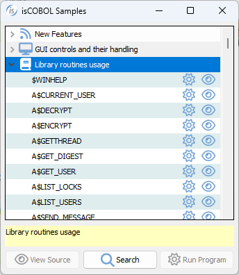
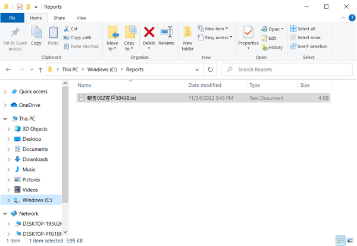

# Library Routines

isCOBOL provides several library routines.

The table below lists the library routines along with their usability in the various scenarios. For each routine it’s specified if it can be used in stand-alone, thin client and web, with some advice where applicable. A detailed documentation of each single routine follows.

Some of the library routines are affected by dedicated configuration properties. See [Library Routines Configuration](../../SDK-Users-Guide/Compiler-and-Runtime/Configuration/Configuration-Properties#library-routines-configuration) for details.

**Note -** Unless specified differently in the notes, routines that access client resources in a WebClient environment work on the server where the WebClient service is running and not on the end user PC where the web browser is running. This rule applies to routines called via CALL CLIENT as well as routine functions that access to the client machine (e.g. C$COPY when one of the parameters starts with "@[DISPLAY]:"\).

| Library Routine /<br> op-code | Kind of execution |  |  |  |  |  |  | Notes |
| --- | --- | --- | --- | --- | --- | --- | --- | --- |
|  | **Stand-Alone** | **Thin Client default on** |  | **Thin Client** | **WebClient** | **WebDirect** | **EIS** |  |
|  |  | **Server** | **Client** | **CALL CLIENT** |  |  |  |  |
| [$WINHELP](./$WINHELP/$WINHELP) | YES | X |  | YES | NO[1] | NO | NO | In thin client, if CALL CLIENT is not used, then the help is opened on the server machine.<br><br>[1]In webClient, the help is opened on the server where webClient is running, so the user can’t see it in the browser. |
| [A$CURRENT_USER](./A$CURRENT_USER) | NO | X |  | NO | YES | NO | NO |  |
| [A$DECRYPT](./A$DECRYPT) | YES | X |  | NO | YES | YES | YES |  |
| [A$ENCRYPT](./A$ENCRYPT) | YES | X |  | NO | YES | YES | YES |  |
| [A$GETTHREAD](./A$GETTHREAD) | NO | X |  | NO | YES | NO | NO |  |
| [A$GET_DIGEST](./A$GET_DIGEST) | YES | X |  | NO | YES | YES | YES |  |
| [A$GET_USER](./A$GET_USER) | NO | X |  | NO | YES | NO | NO |  |
| [A$LIST_LOCKS](./A$LIST_LOCKS/A$LIST_LOCKS) | NO | X |  | NO | YES | NO | NO |  |
| [A$LIST_USERS](./A$LIST_USERS/A$LIST_USERS) | NO | X |  | NO | YES | NO | NO |  |
| [A$SEND_MESSAGE](./A$SEND_MESSAGE) | NO | X |  | NO | YES | NO | NO |  |
| [A$USERINFO](./A$USERINFO/A$USERINFO) | NO | X |  | NO | YES | NO | NO |  |
| [AS$COPY](./AS$COPY) | YES | X |  | NO | YES | NO | NO |  |
| [ASCII2HEX](./ASCII2HEX) | YES | X |  | NO | YES | YES | YES |  |
| [ASCII2OCTAL](./ASCII2OCTAL) | YES | X |  | NO | YES | YES | YES |  |
| [C$ASYNCPOLL](./C$ASYNCPOLL) | YES | X |  | NO | YES | YES | YES |  |
| [C$ASYNCRUN](./C$ASYNCRUN) | YES | X |  | NO | YES | YES | YES |  |
| [C$CALLEDBY](./C$CALLEDBY) | YES | X |  | NO | YES | YES | YES |  |
| [C$CALLERR](./C$CALLERR) | YES | X |  | NO | YES | YES | YES |  |
| [C$CARG](./C$CARG) | YES | X |  | NO | YES | YES | YES |  |
| [C$CENTURY](./C$CENTURY) | YES | X |  | YES | YES | YES | YES |  |
| [C$CHDIR](./C$CHDIR) | YES | X |  | YES | YES | YES | YES |  |
| [C$CODESET](./C$CODESET) | YES | X |  | NO | YES | YES | YES |  |
| [C$CONFIG](./C$CONFIG/C$CONFIG) | YES | X |  | YES | YES | YES | YES |  |
| [C$COPY](./C$COPY) | YES | X |  | YES[1] | YES | YES | YES | [1]For the copy client to client there’s no difference between using the *@[display]:* prefix before file names or calling the routine via CALL CLIENT. |
| [C$COVERAGE](./C$COVERAGE/C$COVERAGE) | YES | X |  | NO | YES | YES | YES |  |
| [C$CREATE_TMP_FILE](./C$CREATE_TMP_FILE) | YES | X |  | YES | YES | YES | YES |  |
| [C$DARG](./C$DARG) | YES | X |  | NO | YES | YES | YES |  |
| [C$DECRYPT](./C$DECRYPT) | YES | X |  | NO | YES | YES | YES |  |
| [C$DELAY](./C$DELAY) | YES | X |  | NO | YES | YES | YES |  |
| [C$DELETE](./C$DELETE) | YES | X |  | YES[1] | YES | YES | YES | [1]For the deletion of a file on the client machine there’s no difference between using the *@[display]:* prefix before the file name or calling the routine via CALL CLIENT. |
| [C$DELTREE](./C$DELTREE) | YES | X |  | YES | YES | YES | YES |  |
| [C$DESKTOP](./C$DESKTOP/C$DESKTOP) | YES | X |  | YES[1] | YES[2] | NO | NO | [1]CALL CLIENT should be used to open a file that resides on the client PC. If the file resides on the server, it's better to use the csFlag parameter.<br>[2]The CDESKTOP-BROWSE op-code opens the URL in a new browser tab. If the URL doesn’t start with "http:", then it’s appended to the webapp URL. The CDESKTOP-OPEN, CDESKTOP-EDIT and CDESKTOP-PRINT op-codes trigger the download of the file to the end user PC. |
| [C$EASYOPEN](./C$EASYOPEN) | YES | X |  | YES[1] | YES[2] | NO[3] | NO[3] | [1]CALL CLIENT should be used to open a file that resides on the client PC. If the file resides on the server, it's better to use the csFlag parameter.<br>[2]In webClient environment it triggers the download of the file to the end user PC.<br>[3]In WebDirect environment you can call the WD2$REDIRECT routine, in EIS environment you can use the displayBinaryFile method of the HttpHandler class (for example comm-Area:>displayBinaryFile(tmp-file-name "application/pdf"). |
| [C$ENCRYPT](./C$ENCRYPT) | YES | X |  | NO | YES | YES | YES |  |
| [C$ENVMAP](./C$ENVMAP) | YES | X |  | NO | YES | YES | YES |  |
| [C$FILEINFO](./C$FILEINFO) | YES | X |  | YES | YES | YES | YES |  |
| [C$FORNAME](./C$FORNAME) | YES | X |  | YES | YES | YES | YES |  |
| [C$FSCOPY](./C$FSCOPY) | YES | X |  | YES | YES | YES | YES |  |
| [C$FSDELETE](./C$FSDELETE) | YES | X |  | YES | YES | YES | YES |  |
| [C$FSFULLNAME](./C$FSFULLNAME) | YES | X |  | NO | YES | YES | YES |  |
| [C$FSRENAME](./C$FSRENAME) | YES | X |  | YES | YES | YES | YES |  |
| [C$FULLNAME](./C$FULLNAME) | YES | X |  | NO | YES | YES | YES |  |
| [C$GETCGI](./C$GETCGI) | NO |  |  | NO | NO | NO | YES |  |
| [C$GETENV](./C$GETENV) | YES | X |  | YES | YES | YES | YES |  |
| [C$GETLASTFILEOP](./C$GETLASTFILEOP) | YES | X |  | NO | YES | YES | YES |  |
| [C$GETLASTFILENAME](./C$GETLASTFILENAME) | YES | X |  | NO | YES | YES | YES |  |
| [C$GETPID](./C$GETPID) | YES | X |  | YES | YES | YES | YES |  |
| [C$GETRUNENV](./C$GETRUNENV) | YES | X |  | NO | YES | YES | YES |  |
| [C$GUICFG](./C$GUICFG) | YES |  | X | NO | YES[1] | YES[2] | YES[2] | By default print jobs are executed  client side.<br>[1] See [Known limitations and differences between WebClient and Thin Client](../../../is-cobol-web-client/Known-limitations-and-differences-between-WebClient-and-Thin-Client) for more information about printing in webClient environment.<br>[2] The WebDirect environment and the EIS environment don't support the print preview. |
| [C$JUSTIFY](./C$JUSTIFY) | YES | X |  | NO | YES | YES | YES |  |
| [C$KEYMAP](./C$KEYMAP) | YES | X |  | NO | YES | YES | NO |  |
| [C$KEYSTROKE](./C$KEYSTROKE) | YES | X |  | NO | YES | YES | NO |  |
| [C$LCONVERT](./C$LCONVERT) | YES | X |  | NO | YES | YES | YES |  |
| [C$LIST_DIRECTORY](./C$LIST_DIRECTORY/C$LIST_DIRECTORY) | YES | X |  | YES | YES | YES | YES |  |
| [C$LIST_ENVIRONMENT](./C$LIST_ENVIRONMENT/C$LIST_ENVIRONMENT) | YES | X |  | YES | YES | YES | YES |  |
| [C$LOCKPID](./C$LOCKPID) | YES | X |  | YES | YES | YES | YES |  |
| [C$MAKEDIR](./C$MAKEDIR) | YES | X |  | YES | YES | YES | YES |  |
| [C$MBAR](./C$MBAR) | YES | X |  | NO | YES | NO | NO |  |
| [C$MONITOR](./C$MONITOR/C$MONITOR) | YES |  | X | NO | NO | NO | NO |  |
| [C$MYFILE](./C$MYFILE) | YES | X |  | NO | YES | YES | YES |  |
| [C$NARG](./C$NARG) | YES | X |  | NO | YES | YES | YES |  |
| [C$NCALLRUN](./C$NCALLRUN) | YES | X |  | YES | YES | YES | YES |  |
| [C$OPENSAVEBOX](./C$OPENSAVEBOX/C$OPENSAVEBOX) | YES |  | X | NO | YES[1] | NO | NO | [1] See [Known limitations and differences between WebClient and Thin Client](../../../is-cobol-web-client/Known-limitations-and-differences-between-WebClient-and-Thin-Client) for more information about opensave dialogs in webClient environment. |
| [C$PARAMNAME](./C$PARAMNAME) | YES | X |  | NO | YES | YES | YES |  |
| [C$PARAMSIZE](./C$PARAMSIZE) | YES | X |  | NO | YES | YES | YES |  |
| [C$PARSEEFD](./C$PARSEEFD/C$PARSEEFD) | YES | X |  | YES | YES | YES | YES |  |
| [C$PRELOAD](./C$PRELOAD) | YES | X |  | NO | YES | YES | YES |  |
| [C$PROFILER](./C$PROFILER/C$PROFILER) | YES | X |  | YES | YES | YES | YES |  |
| [C$PROGINMEM](./C$PROGINMEM) | YES | X |  | NO | YES | YES | YES |  |
| [C$PROGINSTACK](./C$PROGINSTACK) | YES | X |  | NO | YES | YES | YES |  |
| [C$RBMENU](./C$RBMENU) | YES | X |  | NO | YES | NO | NO |  |
| [C$RCONVERT](./C$RCONVERT) | YES | X |  | NO | YES | YES | YES |  |
| [C$REGEXP](./C$REGEXP/C$REGEXP) | YES | X |  | NO | YES | YES | YES |  |
| [C$REPLACE_ALL](./C$REPLACE_ALL) | YES | X |  | NO | YES | YES | YES |  |
| [C$RERR](./C$RERR) | YES | X |  | NO | YES | YES | YES |  |
| [C$RERRNAME](./C$RERRNAME) | YES | X |  | NO | YES | YES | YES |  |
| [C$RUN](./C$RUN) | YES | X |  | YES | YES | YES | YES |  |
| [C$SBAR](./C$SBAR) | YES | X |  | NO | YES | NO | NO |  |
| [C$SCRD](./C$SCRD) | YES | X |  | NO | YES | NO | NO |  |
| [C$SCWR](./C$SCWR) | YES | X |  | NO | YES | NO | NO |  |
| [C$SETDEVELOPMENTMODE](./C$SETDEVELOPMENTMODE) | YES | X |  | NO | YES[1] | YES | YES | [1] See [Known limitations and differences between WebClient and Thin Client](../../../is-cobol-web-client/Known-limitations-and-differences-between-WebClient-and-Thin-Client) for more information about printing in webClient environment. |
| [C$SETENV](./C$SETENV) | YES | X |  | YES | YES | YES | YES |  |
| [C$SHOW](./C$SHOW) | YES | X |  | NO | YES | YES | NO |  |
| [C$SLEEP](./C$SLEEP) | YES | X |  | NO | YES | YES | YES |  |
| [C$SOCKET](./C$SOCKET/C$SOCKET) | YES | X |  | NO | YES | YES | YES |  |
| [C$SORT](./C$SORT) | YES | X |  | YES | YES | YES | YES |  |
| [C$STRING_CONVERT](./C$STRING_CONVERT) | YES | X |  | NO | YES | YES | YES |  |
| [C$SYSINFO](./C$SYSINFO) | YES | X |  | YES | YES | YES | YES |  |
| [C$SYSTEM](./C$SYSTEM) | YES | X |  | YES | YES | YES | YES |  |
| [C$TBAR](./C$TBAR) | YES | X |  | NO | YES | NO | NO |  |
| [C$TOLOWER](./C$TOLOWER) | YES | X |  | NO | YES | YES | YES |  |
| [C$TOUPPER](./C$TOUPPER) | YES | X |  | NO | YES | YES | YES |  |
| [C$TRIM](./C$TRIM) | YES | X |  | NO | YES | YES | YES |  |
| [C$UNLOAD](./C$UNLOAD) | YES | X |  | YES | YES | YES | YES |  |
| [C$UNLOAD_NATIVE](./C$UNLOAD_NATIVE) | YES | X[1] |  | YES | YES | NO[1] | NO[1] | [1]The routine will always fail when called in these cases to avoid unloading a library that other clients may need. |
| [C$UNSET](./C$UNSET) | YES | X |  | YES | YES | YES | YES |  |
| [C$VERSION](./C$VERSION) | YES | X |  | YES | YES | YES | YES |  |
| [C$WRITELOG](./C$WRITELOG) | YES | X |  | YES | YES | YES | YES |  |
| [C$WRU](./C$WRU) | YES | X |  | NO | YES | YES | YES |  |
| [C$XML](./C$XML/C$XML) | YES | X |  | YES | YES | YES | YES |  |
| [CBL_ALLOC_MEM](./CBL_ALLOC_MEM) | YES | X |  | YES | YES | YES | YES |  |
| [CBL_AND](./CBL_AND) | YES | X |  | NO | YES | YES | YES |  |
| [CBL_CHANGE_DIR](./CBL_CHANGE_DIR) | YES | X |  | YES | YES | YES | YES |  |
| [CBL_CHECK_FILE_EXIST](./CBL_CHECK_FILE_EXIST) | YES | X |  | YES | YES | YES | YES |  |
| [CBL_CLEAR_SCR](./CBL_CLEAR_SCR) | YES | X |  | NO | YES | NO | NO |  |
| [CBL_CLOSE_FILE](./CBL_CLOSE_FILE) | YES | X |  | YES | YES | YES | YES |  |
| [CBL_COPY_FILE](./CBL_COPY_FILE) | YES | X |  | YES | YES | YES | YES |  |
| [CBL_CREATE_DIR](./CBL_CREATE_DIR) | YES | X |  | YES | YES | YES | YES |  |
| [CBL_CREATE_FILE](./CBL_CREATE_FILE) | YES | X |  | YES | YES | YES | YES |  |
| [CBL_DELETE_DIR](./CBL_DELETE_DIR) | YES | X |  | YES | YES | YES | YES |  |
| [CBL_DELETE_FILE](./CBL_DELETE_FILE) | YES | X |  | YES | YES | YES | YES |  |
| [CBL_DIR_SCAN_START](./CBL_DIR_SCAN_START) | YES | X |  | YES | YES | YES | YES |  |
| [CBL_DIR_SCAN_READ](./CBL_DIR_SCAN_READ) | YES | X |  | YES | YES | YES | YES |  |
| [CBL_DIR_SCAN_END](./CBL_DIR_SCAN_END) | YES | X |  | YES | YES | YES | YES |  |
| [CBL_EQ](./CBL_EQ) | YES | X |  | NO | YES | YES | YES |  |
| [CBL_ERROR_PROC](./CBL_ERROR_PROC) | YES | X |  | NO | YES | YES | YES |  |
| [CBL_EXEC_RUN_UNIT](./CBL_EXEC_RUN_UNIT) | YES | X |  | YES | YES | YES | YES |  |
| [CBL_EXIT_PROC](./CBL_EXIT_PROC) | YES | X |  | NO | YES | YES | YES |  |
| [CBL_FLUSH_FILE](./CBL_FLUSH_FILE) | YES | X |  | YES | YES | YES | YES |  |
| [CBL_FREE_MEM](./CBL_FREE_MEM) | YES | X |  | NO | YES | YES | YES |  |
| [CBL_GET_CURRENT_DIR](./CBL_GET_CURRENT_DIR) | YES | X |  | YES | YES | YES | YES |  |
| [CBL_GET_KBD_STATUS](./CBL_GET_KBD_STATUS) | YES |  | X | NO | YES | NO | NO |  |
| [CBL_GET_SCR_SIZE](./CBL_GET_SCR_SIZE) | YES |  | X | NO | YES | NO | NO |  |
| [CBL_IMP](./CBL_IMP) | YES | X |  | NO | YES | YES | YES |  |
| [CBL_JOIN_FILENAME](./CBL_JOIN_FILENAME) | YES | X |  | NO | YES | YES | YES |  |
| [CBL_LOCATE_FILE](./CBL_LOCATE_FILE) | YES | X |  | NO | YES | YES | YES |  |
| [CBL_NOT](./CBL_NOT) | YES | X |  | NO | YES | YES | YES |  |
| [CBL_OPEN_FILE](./CBL_OPEN_FILE) | YES | X |  | YES | YES | YES | YES |  |
| [CBL_OR](./CBL_OR) | YES | X |  | NO | YES | YES | YES |  |
| [CBL_READ_DIR](./CBL_READ_DIR) | YES | X |  | YES | YES | YES | YES |  |
| [CBL_READ_FILE](./CBL_READ_FILE) | YES | X |  | YES | YES | YES | YES |  |
| [CBL_READ_KBD_CHAR](./CBL_READ_KBD_CHAR) | YES |  | X | NO | YES | NO | NO |  |
| [CBL_READ_SCR_CHARS](./CBL_READ_SCR_CHARS) | YES |  | X | NO | YES | NO | NO |  |
| [CBL_READ_SCR_CHATTRS](./CBL_READ_SCR_CHATTRS) | YES |  | X | NO | YES | NO | NO |  |
| [CBL_SPLIT_FILENAME](./CBL_SPLIT_FILENAME) | YES | X |  | NO | YES | YES | YES |  |
| [CBL_RENAME_FILE](./CBL_RENAME_FILE) | YES | X |  | YES | YES | YES | YES |  |
| [CBL_THREAD_SLEEP](./CBL_THREAD_SLEEP) | YES | X |  | NO | YES | YES | YES |  |
| [CBL_TOLOWER](./CBL_TOLOWER) | YES | X |  | NO | YES | YES | YES |  |
| [CBL_TOUPPER](./CBL_TOUPPER) | YES | X |  | NO | YES | YES | YES |  |
| [CBL_WRITE_FILE](./CBL_WRITE_FILE) | YES | X |  | YES | YES | YES | YES |  |
| [CBL_WRITE_SCR_CHARS](./CBL_WRITE_SCR_CHARS) | YES |  | X | NO | YES | NO | NO |  |
| [CBL_WRITE_SCR_CHATTRS](./CBL_WRITE_SCR_CHATTRS) | YES |  | X | NO | YES | NO | NO |  |
| [CBL_WRITE_SCR_N_CHAR](./CBL_WRITE_SCR_N_CHAR) | YES |  | X | NO | YES | NO | NO |  |
| [CBL_WRITE_SCR_N_CHATTR](./CBL_WRITE_SCR_N_CHATTR) | YES |  | X | NO | YES | NO | NO |  |
| [CBL_XOR](./CBL_XOR) | YES | X |  | NO | YES | YES | YES |  |
| [DCI Routines](./DCI-Routines) | YES | X |  | NO | YES | YES | YES |  |
| [DISPLAY_REG Routines](./REG-Routines/REG-Routines) | YES |  | X | NO | YES | YES | YES |  |
| [DELETE](./DELETE) | YES | X |  | YES | YES | YES | YES |  |
| [EDBI_DISCONNECT](./EDBI_DISCONNECT/EDBI_DISCONNECT) | YES | X |  | NO | YES | YES | YES |  |
| [ESQL$BLOB](./ESQL$BLOB/ESQL$BLOB) | YES | X |  | NO | YES | YES | YES |  |
| [HEX2ASCII](./HEX2ASCII) | YES | X |  | NO | YES | YES | YES |  |
| [I$IO](./I$IO/I$IO) | YES | X |  | YES | YES | YES | YES |  |
| [IWC$GET](./IWC$GET) | YES | X |  | NO | YES | YES | YES |  |
| [IWC$GET](./IWC$GET) | NO |  |  | NO | YES | NO | NO |  |
| [IWC$INIT](./IWC$INIT) | NO |  |  | NO | YES | NO | NO |  |
| [IWC$SEND](./IWC$SEND) | NO |  |  | NO | YES | NO | NO |  |
| [IWC$STOP](./IWC$STOP) | NO |  |  | NO | YES | NO | NO |  |
| [J$GETFROMLAF](./J$GETFROMLAF/J$GETFROMLAF) | YES |  | X | NO | NO | NO | NO |  |
| [J$NETADDRESS](./J$NETADDRESS) | YES | X |  | YES | YES | YES | YES |  |
| [KEISEN](./KEISEN) | YES | X |  | NO | YES | NO | NO |  |
| [KEISEN1](./KEISEN1) | YES | X |  | NO | YES | NO | NO |  |
| [KEISEN2](./KEISEN2) | YES | X |  | NO | YES | NO | NO |  |
| [KEISEN_SELECT](./KEISEN_SELECT) | YES | X |  | NO | YES | NO | NO |  |
| [M$ALLOC](./M$ALLOC) | YES | X |  | NO | YES | YES | YES |  |
| [M$COPY](./M$COPY) | YES | X |  | NO | YES | YES | YES |  |
| [M$FILL](./M$FILL) | YES | X |  | NO | YES | YES | YES |  |
| [M$FREE](./M$FREE) | YES | X |  | NO | YES | YES | YES |  |
| [M$GET](./M$GET) | YES | X |  | NO | YES | YES | YES |  |
| [M$PUT](./M$PUT) | YES | X |  | NO | YES | YES | YES |  |
| [M$SIZE](./M$SIZE) | YES | X |  | NO | YES | YES | YES |  |
| [OCTAL2ASCII](./OCTAL2ASCII) | YES | X |  | NO | YES | YES | YES |  |
| [P$ Routines](./P$-Routines/P$-Routines) | YES |  | X | NO | YES[1] | YES[2] | YES[2] | [1] See [Known limitations and differences between WebClient and Thin Client](../../../is-cobol-web-client/Known-limitations-and-differences-between-WebClient-and-Thin-Client) for more information about printing in webClient environment.]<br>[2]The answer is NO for P$DISPLAYDIALOG |
| [R$IO](./R$IO/R$IO) | YES | X |  | YES | YES | YES | YES |  |
| [REG Routines](./REG-Routines/REG-Routines) | YES | X |  | YES | YES | YES | YES |  |
| [RENAME](./RENAME) | YES | X |  | YES | YES | YES | YES |  |
| [S$IO](./S$IO/S$IO) | YES | X |  | YES | YES | YES | YES |  |
| [SYSTEM](./SYSTEM) | YES | X |  | YES | YES | YES | YES |  |
| [W$BITMAP](./W$BITMAP/W$BITMAP) | YES | X |  | NO | YES | YES[1] | NO | [1]The WBITMAP-LOAD-FROM-CLIENT function is not supported under WebDirect. |
| [W$CAPTURE](./W$CAPTURE) | YES |  | X | NO | NO | NO | NO |  |
| [W$CENTER_WINDOW](./W$CENTER_WINDOW) | YES |  | X | NO | YES | NO | NO |  |
| [W$CREATEFONT](./W$CREATEFONT) | YES | X |  | NO | YES | YES | YES |  |
| [W$FLUSH](./W$FLUSH/W$FLUSH) | YES |  | X | NO | YES | YES | NO |  |
| [W$FONT](./W$FONT/W$FONT) | YES | X |  | NO | YES | YES[1] | YES[1][2] | [2]The WFONT-CHOOSE-FONT function is not supported under EIS and WebDirect.<br>[2]Supported only to manage printer fonts. |
| [W$GETC](./W$GETC) | YES |  | X | NO | YES | NO | NO |  |
| [W$HINT](./W$HINT) | YES |  | X | NO | YES | NO | NO |  |
| [W$IMAGESIZE](./W$IMAGESIZE) | YES | X |  | NO | YES | YES | NO |  |
| [W$KEYBUF](./W$KEYBUF/W$KEYBUF) | YES | X |  | NO | YES | NO | NO |  |
| [W$MENU](./W$MENU/W$MENU) | YES |  | X | NO | YES[1] | YES[1] | NO | [1]In webClient and WebDirect it’s not possible to display a menu on the try icon. |
| [W$MOUSE](./W$MOUSE/W$MOUSE) | YES |  | X | NO | YES | YES[1] | NO | [1]In WebDirect it’s not possible to set a custom mouse shape and get the mouse status |
| [W$PALETTE](./W$PALETTE/W$PALETTE) | YES |  | X | NO | YES | YES[1] | NO | [1]The WPALETTE-CHOOSE-COLOR function is not supported under WebDirect. |
| [W$PROGRESSDIALOG](./W$PROGRESSDIALOG/W$PROGRESSDIALOG) | YES | X |  | NO | YES | NO | NO |  |
| [W$ROTATE](./W$ROTATE) | YES | X |  | NO | YES | YES | YES |  |
| [W$SAVE_IMAGE](./W$SAVE_IMAGE) | YES | X |  | NO | YES | YES | YES |  |
| [W$SCALE](./W$SCALE) | YES | X |  | NO | YES | YES | YES |  |
| [W$TEXTSIZE](./W$TEXTSIZE) | YES |  | X | NO | YES | YES | NO |  |
| [WD2$CLIENT_INFO](./WD2$CLIENT_INFO/WD2$CLIENT_INFO) | NO |  |  | NO | NO | YES | NO |  |
| [WD2$EXECJS](./WD2$EXECJS) | NO |  |  | NO | NO | YES | NO |  |
| [WD2$REDIRECT](./WD2$REDIRECT) | NO |  |  | NO | NO | YES | NO |  |
| [WD2$RUN_JS](./WD2$RUN_JS) | NO |  |  | NO | NO | YES | NO |  |
| [WD2$SESSION](./WD2$SESSION/WD2$SESSION) | NO |  |  | NO | NO | YES | NO |  |
| [WIN$PLAYSOUND](./WIN$PLAYSOUND) | YES |  | X | NO | NO[1] | NO | NO | [1] In webClient, the sound is played on the server where webClient is running, so the end user can’t hear it. |
| [WIN$PRINTER](./WIN$PRINTER/WIN$PRINTER) | YES |  | X | NO | YES[1] | YES | YES | [1] See [Known limitations and differences between WebClient and Thin Client](../../../is-cobol-web-client/Known-limitations-and-differences-between-WebClient-and-Thin-Client) for more information about printing in webClient environment. |
| [WIN$VERSION](./WIN$VERSION) | YES | X |  | YES | YES | YES | YES |  |
| [WOW Routines](./WOW-Routines/WOW-Routines) | YES | X |  | YES | NO | NO | NO |  |

To override one of these library routines you can compile with the [-sysc](../../SDK-Users-Guide/Compiler-and-Runtime/Compiler/Compiler-Options#sysc) option.

Sample programs for each library routine are available among the isCOBOL Samples.



## Alphanumeric and National parameters

Unless differently specified in the routine documentation, wherever a parameter is described as PIC X(n) you’re allowed to use PIC N(n) instead.

By using a national data item you can deal with a greater number of characters than the ones supported by the current character set. This is particularly useful if you have to deal with files whose name includes characters that are not supported by the current encoding.

Suppose for example that you’re working on a Windows Latin-1 platform where the encoding is CP1252 and you have a file with Chinese characters in the name.



Library routines like [C$COPY](./C$COPY), [C$DELETE](./C$DELETE), [C$FILEINFO](./C$FILEINFO), [C$LIST_DIRECTORY](./C$LIST_DIRECTORY/C$LIST_DIRECTORY) and [C$OPENSAVEBOX](./C$OPENSAVEBOX/C$OPENSAVEBOX) will not be able to receive the file name correctly is you use PIC X(n) parameters. Instead, by switching to PIC N(n) parameters they will be able to receive the file name correctly.

**Note -** The [C$OPENSAVEBOX](./C$OPENSAVEBOX/C$OPENSAVEBOX) routine doesn’t receive the file name in an elementary parameter, but it uses a group data-item named OPENSAVE-DATA defined in the isopensave.def copybook. In order to use PIC N(n) items with this routine, include the copybook as follows:

```cobol
 copy "isopensave.def" replacing ==pic x== by ==pic n==.
```
