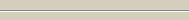

## BAR

A Bar is a line consisting of a number of one-pixel rows. Each row can be rendered with different color, size or shading, in order to match all the programmer's needs.

When the [Lines](./Properties/Lines) property is zero, the bar is horizontal. When the [Size](./Properties/Size) property is zero, the bar is vertical.
