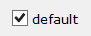

## CHECK-BOX

A Check-Box is used to represent a boolean value. It consists of a graphic box that shows the state of the value (on or off) and an optional text. The appearance of the graphic box, as well as the relative position of the text, can be customized.
