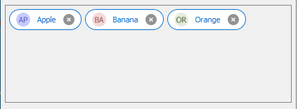

## CHIPS-BOX

Chips are small, interactive elements that represent complex information in a compact form. They are often used to display tags, categories, or selected items. Chips can include text, icons and images, and they can be interactive, allowing users to add or remove them.
