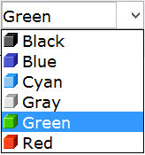

## COMBO-BOX

A Combo-Box combines an Entry-Field and a list that can be used to pick a value. Depending on the styles set, the Entry-Field can be editable or not.

The list is open by a left mouse click, by pressing F4 or by pressing ALT along with either the up arrow key or the down arrow key.

The list width depends on the current Look & Feel: with most Look & Feels, the list has the same width of the Entry-Field and some items could appear truncated if this width is not enough. With some Look & Feels, like FlatLaf, instead, the list may extend over the Entry-Field’s width to ensure that all the items are fully readable.
