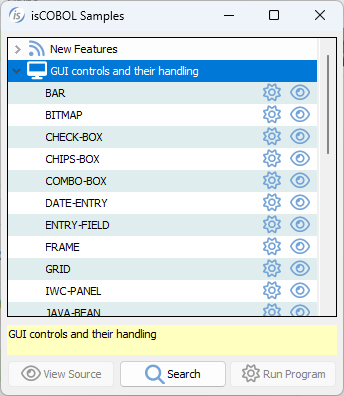
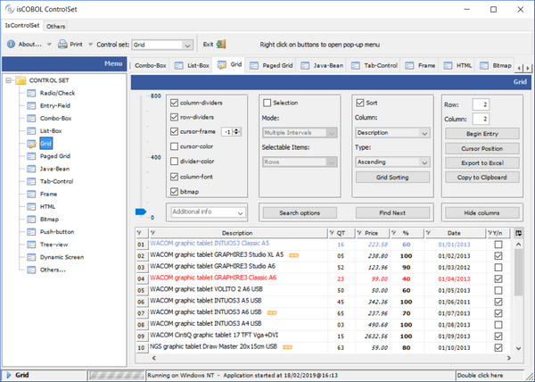

# Controls Reference

This chapter describes all the graphical controls that can appear in the program Screen Section.

Basic sample programs for each control are available amongst the isCOBOL Samples.

The advanced usage of graphical controls is shown in the isCOBOL Demo.

