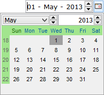

## DATE-ENTRY

A Date-Entry is a special Entry-Field that allows you to display and enter date or time information. A button on its right side allows the user to pop-up a calendar to pick dates.

The calendar’s appearance is conditioned by the international settings of the machine that uses it: months and days names are translated to the local language and the displayed date format respects the international settings (unless you set [Display-Format](./Properties/Display-Format) to a precise date format).
