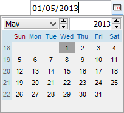

## Numeric

When this style is set, the Date-Entry layout changes. Spinner buttons are not shown anymore and the user can type numbers freely like he does in a standard Entry-Field without having to click on the year, on the month and on the day to modify their values.



This style also activates a real-time validation of the dates input by the user. The text is colored in greed for valid dates and in red for invalid dates during editing.

**Note -** this style can’t be set dynamically through MODIFY and, when this style is set, also DISPLAY-FORMAT can’t be changed dynamically through MODIFY.

**Example** - Define a date-entry control that allows direct numeric entry

```cobol
screen section.
...
  03 screen-1-de-2 Date-Entry
     line 28.5
     column 49.7
     size 13.6 cells
     lines 4.3 cells
     id 18
     century-date
     numeric
     value-format davf-yyyymmdd
     calendar-font Default-Font
     .
```
