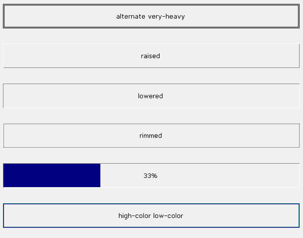

## FRAME

A Frame is a box that has a merely cosmetic purpose. It can be used to visually define areas on the screen.

### Placing controls inside a Frame

Although frames are perceived as containers by the user, they’re just bars on the screen from the program’s point of view. The [Line](../../../Appendices/Graphical-Control-List) and [Col](../../../Appendices/Graphical-Control-List) properties of the controls you display inside a frame are relative to the window, not to the frame.
