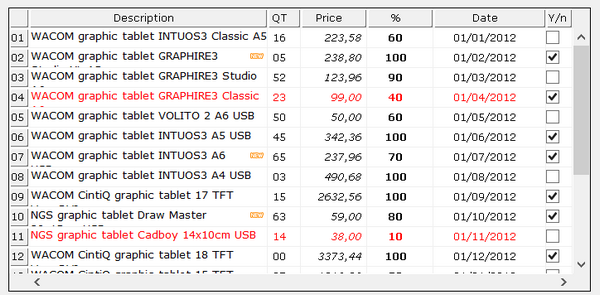

## GRID



A Grid is a two-dimensional table. It can be customized to meet programmer's needs and cells can hold controls, such as Combo-Boxes, Push-Buttons and Entry-Fields.

Information is organized in rows and columns, and the cells are addressed by row and column coordinates.

### Colors and Fonts

Since each element of a Grid can be rendered with different colors and fonts and elements can be overlapped, priority rules are needed.

Colors are applied according to the following list of priorities. Items are listed from the most important to the least important:

- [Cell-Entry-Color](./Properties/Cell-Entry-Color), [Cell-Entry-Foreground-Color](./Properties/Cell-Entry-Foreground-Color), [Cell-Entry-Background-Color](./Properties/Cell-Entry-Background-Color)
- [Cursor-Color](./Properties/Cursor-Color), [Cursor-Foreground-Color](./Properties/Cursor-Foreground-Color), [Cursor-Background-Color](./Properties/Cursor-Background-Color)
- [Cell-Selected-Color](./Properties/Cell-Selected-Color), [Cell-Selected-Foreground-Color](./Properties/Cell-Selected-Foreground-Color), [Cell-Selected-Background-Color](./Properties/Cell-Selected-Background-Color)
- [Drag-Color](./Properties/Drag-Color), [Drag-Foreground-Color](./Properties/Drag-Foreground-Color), [Drag-Background-Color](./Properties/Drag-Background-Color)
- [Region-Color](./Properties/Region-Color), [Region-Foreground-Color](./Properties/Region-Foreground-Color), [Region-Background-Color](./Properties/Region-Background-Color)
- [Cell-Color](./Properties/Cell-Color), [Cell-Foreground-Color](./Properties/Cell-Foreground-Color), [Cell-Background-Color](./Properties/Cell-Background-Color)
- [Heading-Rollover-Color](./Properties/Heading-Rollover-Color), [Heading-Rollover-Foreground-Color](./Properties/Heading-Rollover-Foreground-Color), [Heading-Rollover-Background-Color](./Properties/Heading-Rollover-Background-Color)
- [Heading-Cursor-Color](./Properties/Heading-Cursor-Color), [Heading-Cursor-Foreground-Color](./Properties/Heading-Cursor-Foreground-Color), [Heading-Cursor-Background-Color](./Properties/Heading-Cursor-Background-Color)
- [Heading-Color](./Properties/Heading-Color), [Heading-Foreground-Color](./Properties/Heading-Foreground-Color), [Heading-Background-Color](./Properties/Heading-Background-Color)
- [Row-Selected-Color](./Properties/Row-Selected-Color), [Row-Selected-Foreground-Color](./Properties/Row-Selected-Foreground-Color), [Row-Selected-Background-Color](./Properties/Row-Selected-Background-Color)
- [Row-Cursor-Color](./Properties/Row-Cursor-Color), [Row-Cursor-Foreground-Color](./Properties/Row-Cursor-Foreground-Color), [Row-Cursor-Background-Color](./Properties/Row-Cursor-Background-Color)
- [Row-Rollover-Color](./Properties/Row-Rollover-Color), [Row-Rollover-Foreground-Color](./Properties/Row-Rollover-Foreground-Color), [Row-Rollover-Background-Color](./Properties/Row-Rollover-Background-Color)
- [Row-Color](./Properties/Row-Color), [Row-Foreground-Color](./Properties/Row-Foreground-Color), [Row-Background-Color](./Properties/Row-Background-Color)
- [Column-Selected-Color](./Properties/Column-Selected-Color), [Column-Selected-Foreground-Color](./Properties/Column-Selected-Foreground-Color), [Column-Selected-Background-Color](./Properties/Column-Selected-Background-Color)
- [Column-Color](./Properties/Column-Color), [Column-Foreground-Color](./Properties/Column-Foreground-Color), [Column-Background-Color](./Properties/Column-Background-Color)
- [Row-Color-Pattern](./Properties/Row-Color-Pattern), [Row-Foreground-Color-Pattern](./Properties/Row-Foreground-Color-Pattern), [Row-Background-Color-Pattern](./Properties/Row-Background-Color-Pattern)
- [Color](./Properties/Color), [Foreground-Color](./Properties/Foreground-Color), [Background-Color](./Properties/Background-Color)

Fonts are applied according to the following list of priorities. Items are listed from the most important to the least important:

- [Cell-Font](./Properties/Cell-Font)
- [Heading-Font](./Properties/Heading-Font)
- [Row-Font](./Properties/Row-Font)
- [Column-Font](./Properties/Column-Font)
- [Font](./Properties/Font)

Protections are applied according to the following list of priorities. Items are listed from the most important to the least important:

- [Cell-Protection](./Properties/Cell-Protection)
- [Row-Protection](./Properties/Row-Protection)
- [Column-Protection](./Properties/Column-Protection)
- [Protection](./Properties/Protection)

**Note** - Cells color and font might be ovverridden by embedded controls (see [Embedding controls](./GRID) below, for details). The embedded control might specify explicit COLOR and FONT properties or might be automatically colored by the runtime if you set configuration properties like [iscobol.gui.curr_bcolor](../../../SDK-Users-Guide/Compiler-and-Runtime/Configuration/Configuration-Properties) and [iscobol.gui.curr_fcolor](../../../SDK-Users-Guide/Compiler-and-Runtime/Configuration/Configuration-Properties). These colors and fonts have priority over the Grid cell color and font.

### Filtering and finding data


Grids provide a integrated "find all" feature that is activated by pressing CTRL+F when the focus is on the Grid. When CTRL+F is pressed, the following panel is shown at the top of the Grid:

The X button on the left allows you to close the panel. When the panel is closed, the Grid data is restored.

The Combo-Box in the middle allows you to input the text you’re looking for. As you type text in the field, the Grid rows that don’t include your text are made invisible. The other rows show the matching text highlighted unless the [Alignment](./Properties/Alignment) of the column is "H".

Pressing Enter stores your text in the Combo-Box. If you wish to search the same text later, you can select it from the Combo-Box instead of typing it from scratch. The text remains stored until the Grid is destroyed.

Clicking the Clear button clears the text area of the Combo-Box and restores all the data in the Grid.

Clicking the Case button allows you to switch between a case insensitive search ("AA") and a case sensitive search ("Aa").

The layout of the search panel can be configured globally with the [iscobol.gui.search_panel_settings](../../../SDK-Users-Guide/Compiler-and-Runtime/Configuration/Configuration-Properties) configuration property or for specific Grid controls with the [SearchPanelSettings Class (com.iscobol.gui.server.SearchPanelSettings)](../../../Appendices/Internal-Objects/SearchPanelSettings-Class) class.

The integrated "find all" feature can be disabled by setting the [Search-Panel](./Properties/Search-Panel) property to -1.

The [Filterable-Columns](./Styles/Filterable-Columns) style and the [Filter-Types](./Properties/Filter-Types) property, instead, allow you to filter data according to the content of a Grid column.

The [Row-Hiding](./Properties/Row-Hiding) property is automatically set to 1 for the rows discarded by data filtering and 0 for the rows that were left visible.

The search panel and the filter dialogs inherit the font from the Grid heading.

### Embedding controls

Other graphical controls can be displayed in grid cells using the [DISPLAY](../../../Language-Reference/Procedure-Division-Statements/DISPLAY) statement.

The cell data is used as the initial value of the graphical control, regardless of any [Value](../../../Appendices/Graphical-Control-List) property specified in the [DISPLAY](../../../Language-Reference/Procedure-Division-Statements/DISPLAY) statement.

Any user modification to the control’s content updates the [Cell-Data](./Properties/Cell-Data) property accordingly.

The following program, creates a Grid control that uses Check-Boxes to display and accept data on the first column and Combo-boxes to accept data on the second column:

```cobol
       program-id. grid-sample.
       working-storage section.
       copy "iscrt.def".
       copy "isgui.def".
       77 MainWindow handle of window.
       77 My-Combo-Box handle of combo-box occurs 10.
       77 My-Check-Box handle of check-box occurs 10.
       77 idx pic 9(2) value 0.
       77 keystatus pic 9(5) special-names crt status.
           88 esc value 27.
       screen section.
       01 Screen1.
           03 My-Grid grid LINE 2, COL 2, SIZE 70 CELLS, LINES 5,
              DISPLAY-COLUMNS (1, 11, 26, 46), NUM-ROWS 10,
              hscroll vscroll
              event procedure My-Grid-Event-Handler.
       procedure division.
       Main-Logic.
           display standard graphical window background-low
                 handle MainWindow
           display Screen1
           perform varying idx from 1 by 1 until idx > 10
              display Check-Box
                      handle My-Check-Box(idx)
                      event check-evt
                      upon My-Grid(idx, 1)
              display Combo-Box lines 5
                      handle My-Combo-Box(idx)
                      ITEM-TO-ADD ("Item1", "Item2", "Item3",
                                   "Item4", "Item5", "Item6")
                      notify-selchange
                      event combo-evt
                      upon My-Grid(idx, 2)
           end-perform
           perform until esc
              accept Screen1 on exception continue end-accept
           end-perform
           perform varying idx from 1 by 1 until idx > 10
              destroy My-Check-Box(idx)
              destroy My-Combo-Box(idx)
           end-perform
           stop run
           .

       My-Grid-Event-Handler.
           display " grid event-type [" event-type "]"
                   upon sysout
           .
       check-evt.
           display " check-box event-type [" event-type "]"
                   upon sysout
           .
       combo-evt.
           display " combo-box event-type [" event-type "]"
                   upon sysout
           .
```

In order to create a control on each row of a column, the special value -1 can be used as y coordinate. According to the above example, this syntax

```cobol
           perform varying idx from 1 by 1 until idx > 10
              display Check-Box
                      handle My-Check-Box(idx)
                      event check-evt
                      upon My-Grid(idx, 1)
              display Combo-Box lines 5
                      handle My-Combo-Box(idx)
                      ITEM-TO-ADD ("Item1", "Item2", "Item3",
                                   "Item4", "Item5", "Item6")
                      notify-selchange
                      event combo-evt
                      upon My-Grid(idx, 2)
           end-perform
```

Could be rewritten as

```cobol
              display Check-Box
                      handle My-Check-Box(idx)
                      event check-evt
                      upon My-Grid(-1, 1)
              display Combo-Box lines 5
                      handle My-Combo-Box(idx)
                      ITEM-TO-ADD ("Item1", "Item2", "Item3",
                                   "Item4", "Item5", "Item6")
                      notify-selchange
                      event combo-evt
                      upon My-Grid(-1, 2)
```

**Note:** Check-Box, Push-Button and Frame are shown permanently on the grid. Other controls are shown only when the user clicks on the cell. Pressing F4 when the focus is on the Combo-Box within a Grid cell doesn’t drop the list of values.

Controls can also be shown only during the editing of a cell by displaying them in the [MSG-BEGIN-ENTRY](./Events/MSG-BEGIN-ENTRY) event and destroying them in the [MSG-CANCEL-ENTRY](./Events/MSG-CANCEL-ENTRY) and [MSG-FINISH-ENTRY](./Events/MSG-FINISH-ENTRY) events, as shown in the below example:

```cobol
       program-id. Grid1.
       working-storage section.
       copy "iscrt.def".
       copy "isgui.def".
       77  MainWindow      handle of window.
       77  My-Combo-Box    handle of combo-box.
       screen section.
       01  Screen1.
           03 My-Grid grid LINE 2, COL 2, SIZE 70 CELLS, LINES 5,
              DISPLAY-COLUMNS (1, 11, 26, 46), NUM-ROWS 50,
              event procedure My-Grid-Event-Handler.
       procedure division.
       Main-Logic.
           display standard graphical window background-low
                 handle MainWindow
           display Screen1
           perform until 1 = 2
              accept Screen1 on exception continue end-accept
           end-perform
           stop run
           .
       My-Grid-Event-Handler.
           evaluate event-type
           when msg-begin-entry
                display Combo-Box lines 5
                        handle My-Combo-Box
                        ITEM-TO-ADD ("Item1", "Item2", "Item3",
                                     "Item4", "Item5", "Item6")
                        upon My-Grid(event-data-2, event-data-1)
           when msg-cancel-entry
           when msg-finish-entry
                destroy My-Combo-Box
           end-evaluate
           .
```

**Note:** Controls cannot be displayed over heading cells.

### Color and Font of embedded controls

Unless you specify a specific font and color in the [DISPLAY](../../../Language-Reference/Procedure-Division-Statements/DISPLAY) statement, the embedded control inherits the font and color of the cell that hosts it.

### Best practice for Check-Box handling

In order to respond to every click in the check-box shown in grid cells, rather than have the runtime consider some of the clicks as go-to-cell actions, the best practice is to assign the Check-Box an Exception-Value and the Self-Act style and intercept the click as an exception of the ACCEPT of the screen. Inquiring the data of the cell that hosts the check-box tells the check-box state. The following sample program demonstrates it:

```cobol
       program-id. GridCheck.
       working-storage section.
       copy "isgui.def".
       copy "iscrt.def".
       77  crt-status special-names crt status pic 9(5).
       77  row pic 999.
       01  rec.
           03 c-1 pic 9   value 1.
           03 c-2 pic xxx value "abc".

       screen section.
       01  screen1.
           03 g grid line 2 col 2 lines 10, size 10 cells
              display-columns (1, 3) virtual-width 9
              data-columns (record-position of c-1,
                            record-position of c-2)
                      .

       procedure division.
       main.
           display standard graphical window.
           display screen1.
           display check-box upon g(-1, 1)
                   self-act, exception-value 100.
           modify g record-to-add rec.
           modify g record-to-add rec.
           perform until exit
             accept screen1 exception crt-status continue end-accept
             if crt-status = 100
                inquire g cursor-y row
                inquire g(row) record-data rec
                evaluate c-1
                when 0
                   display "unchecked check-box in grid at row " row
                           upon sysout

                when 1
                   display "checked check-box in grid at row " row
                           upon sysout
                end-evaluate
             end-if
           end-perform.
           goback.
```
