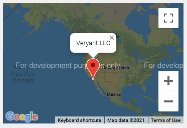

## IWC-PANEL

An IWC-Panel is an area where the embedding HTML page can inject JavaScript components in WebClient environments. For more information about embedding COBOL applications in an HTML page under WebClient see [Embedding the COBOL application in an HTML page](../../../../is-cobol-web-client/Embedding-the-COBOL-application-in-an-HTML-page/Embedding-the-COBOL-application-in-an-HTML-page).
