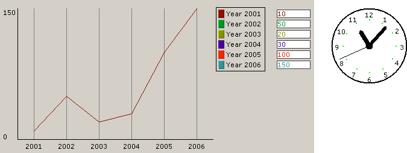

## JAVA-BEAN

Java-beans are external components that can be used by isCOBOL as standard controls. They can be defined in screen section, used by the DISPLAY, MODIFY and INQUIRE statements. They also raise events, that should be handled in the event procedure.

Java AWT components, Java Swing components and JavaFX components can be used as java-beans, but the support of JavaFX components is currently partial as it’s not possible to handle their events.

Some sample programs are installed with isCOBOL. You can find them in the folder $ISCOBOL_HOME/sample/is-java/javabeans.
