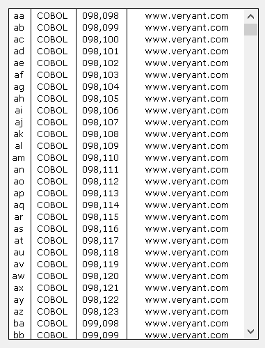

## LIST-BOX

A List-Box is commonly used to show a list of possible choices. The user can pick one of them.

### Colors

Since each element of a List-Box can be rendered with different colors, priority rules are needed.

Colors are applied according to the following list of priorities. Items are listed from the most important to the least important:

- [Selection-Color](./Properties/Selection-Color), [Selection-Foreground-Color](./Properties/Selection-Foreground-Color), [Selection-Background-Color](./Properties/Selection-Background-Color)
- [Item-Color](./Properties/Item-Color), [Item-Foreground-Color](./Properties/Item-Foreground-Color), [Item-Background-Color](./Properties/Item-Background-Color)
- [Row-Color-Pattern](./Properties/Row-Color-Pattern), [Row-Foreground-Color-Pattern](../GRID/Properties/Row-Foreground-Color-Pattern), [Row-Background-Color-Pattern](./Properties/Row-Background-Color-Pattern)
- [Gradient-Color-1](./Properties/Gradient-Color-1), [Gradient-Color-2](./Properties/Gradient-Color-2)
- [Color](./Properties/Color), [Foreground-Color](./Properties/Foreground-Color), [Background-Color](./Properties/Background-Color)

### Filtering data

List-Boxes provide a integrated "find all" feature that is activated by pressing CTRL+F when the focus is on the List-Box. When CTRL+F is pressed, the following panel is shown at the top of the List-Box:

The X button on the left allows you to close the panel. When the panel is closed, the List-Box data is restored.

The Combo-Box in the middle allows you to input the text you’re looking for. As you type text in the field, the List-Box rows that don’t include your text are made invisible. The other rows show the matching text highlighted.

Pressing Enter stores your text in the Combo-Box. If you wish to search the same text later, you can select it from the Combo-Box instead of typing it from scratch. The text remains stored until the List-Box is destroyed.

Clicking the Clear button clears the text area of the Combo-Box and restores all the data in the List-Box.

Clicking the Case button allows you to switch between a case insensitive search ("AA") and a case sensitive search ("Aa").

The integrated "find all" feature can be disabled by setting the [Search-Panel](./Properties/Search-Panel) property to -1.

The search panel uses the same font as the List-Box control.

The layout of the search panel can be configured globally with the [iscobol.gui.search_panel_settings](../../../SDK-Users-Guide/Compiler-and-Runtime/Configuration/Configuration-Properties) configuration property or for specific Grid controls with the [SearchPanelSettings Class (com.iscobol.gui.server.SearchPanelSettings)](../../../Appendices/Internal-Objects/SearchPanelSettings-Class) class.
