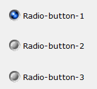

## RADIO-BUTTON

Radio-Buttons are always grouped and are used to select one of several available options. Since they take up considerable space, they are especially used when available options are limited, usually less than ten. When the user clicks a Radio-Button it becomes selected, while the other Radio-Buttons in the same group are unselected.
