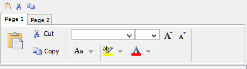

## RIBBON



A Ribbon is a set of controls that are placed within a tool-bar.

Ribbons have a header line followed by a Tab-Control.

The header line is used to host 16X16 pixel bitmap buttons. If no buttons are added to the header line, then the header line is not shown. In order to add a bitmap button to the header line, the ON HEADER style must be applied to the button; the runtime takes care of resizing the button icon to 16x16 if necessary.

The tab-control in the Ribbon is a Tab-Control with [Allow-Container](../TAB-CONTROL/Styles/Allow-Container), [Multiline](../TAB-CONTROL/Styles/Multiline) and [Relative-Offset](../TAB-CONTROL/Styles/Relative-Offset) styles and it's used to host tool-bar items (commonly push-buttons).

Since controls in a Ribbon cannot be activated with the keyboard, the Ribbon should contain only shortcuts to commands that can be activated elsewhere with the keyboard. Usually a Ribbon's contents replicate menu functions.

Controls are added to the Ribbon using a Format 2 DISPLAY statement.

The following statement adds a push-button to the header line:

```cobol
display  push-button bitmap
         bitmap-handle copy-icon
         bitmap-number 1
         exception-value 101
         title "copy"
         on-header
         upon screen-1-rbn-1.
```

The following statement adds a push-button to the first page of the tab-control area:

```cobol
display  push-button bitmap
         bitmap-handle copy-icon
         bitmap-number 1
         exception-value 101
         title "copy"
         upon screen-1-rbn-1(1).
```

The [Line](../../../Appendices/Graphical-Control-List) and [Col](../../../Appendices/Graphical-Control-List) properties of the controls you display inside a Ribbon are relative to the Ribbon.
