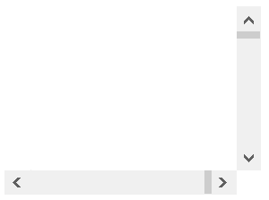

## SCROLL-PANE



Scroll-Pane is a control that provides a scrolled, clipped viewport of its contents. It allows the user to scroll the content around either directly or by using scroll bars. When the window dimensions are limited, use a scroll-pane to display a screen that wouldn’t fit the window dimensions.

### Placing controls inside a Scroll-Pane

The Scroll-Pane content can be defined in the Screen Section of the program by setting the scroll-group clause of a group of controls to the name of the Scroll-Pane. For example, the following Screen Section snippet defines a Scroll-Pane with 3 fields inside:

```cobol
        03 sp-1 scroll-pane
           line 3, col 3, lines 10 cells, size 30 cells
           .
        03 sp1-content scroll-group sp-1.
           05 ef-1 entry-field
              line 2, col 2, size 10 cells.
           05 ef-2 entry-field
              line 4, col 2, size 10 cells.
           05 ef-3 entry-field
              line 6, col 2, size 10 cells.
```

Controls can also be dynamically added to a Scroll-Pane by using a Format 2 [DISPLAY](../../../Language-Reference/Procedure-Division-Statements/DISPLAY) statement. For example, the following statement adds a fourth field to the above Scroll-Pane:

```cobol
           display entry-field upon sp-1
              line 8, col 2, size 10 cells
              handle ef-4.
```

The [Line](../../../Appendices/Graphical-Control-List) and [Col](../../../Appendices/Graphical-Control-List) properties of the controls you display inside a Scroll-Pane are relative to the Scroll-Pane.
