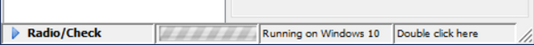

## STATUS-BAR

A Status-Bar is always shown at the bottom of the screen and it is used to show information. It can be divided into several clickable panels, that can contain graphics, text or both.
