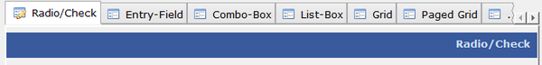

## TAB-CONTROL



A Tab-Control holds one or more Tabs that can be activated by the user, one at a time. It is commonly used to display several pages of controls on the same screen. When a Tab is clicked, the corresponding page is made visible. Tabs can contain graphics, text or both.

### Placing controls inside a Tab-Control

There are two types of Tab-Control:

- the standard Tab-Control,
- the Tab-Control with the [Allow-Container](./Styles/Allow-Container) style.

The standard Tab-Control is not a real container, it’s just an area with some buttons that produce the [CMD-TABCHANGED](./Events/CMD-TABCHANGED) event when clicked. It’s program duty to display controls at the proper coordinates to make them appear over the Tab-Control. The [Line](../../../Appendices/Graphical-Control-List) and [Col](../../../Appendices/Graphical-Control-List) properties of the controls you display inside a standard Tab-Control are relative to the window, not to the Tab-Control. This is a legacy implementation supported for compatibility with ACUCOBOL-GT.

The Tab-Control with the [Allow-Container](./Styles/Allow-Container) style instead is a real container and the runtime takes care of displaying the correct set of controls when the user switches from one page to another. The Tab-Control content can be defined in the Screen Section of the program by setting the tab-group and tab-group-value clauses of a group of controls to the name of the Tab-Control. For example, the following Screen Section snippet defines a Tab-Control with 4 fields inside, 2 in the first page and 2 in the second page:

```cobol
        03 tc-1 tab-control allow-container relative-offset
           line 3, col 3, lines 10 cells, size 30 cells
           tab-to-add ("Page 1", "Page 2")
           .
        03 tc-1-page-1 tab-group tc-1, tab-group-value 1.
           05 ef-1 entry-field
              line 2, col 2, size 10 cells.
           05 ef-2 entry-field
              line 4, col 2, size 10 cells.
        03 tc-1-page-2 tab-group tc-1, tab-group-value 2.
           05 ef-3 entry-field
              line 2, col 2, size 10 cells.
           05 ef-4 entry-field
              line 4, col 2, size 10 cells.
```

Controls can also be dynamically added to Tab-Control pages by using a Format 2 [DISPLAY](../../../Language-Reference/Procedure-Division-Statements/DISPLAY) statement. For example, the following statements add two new fields to the above Tab-Control, one in the first page and the other in the second page:

```cobol
           display entry-field upon tc-1-page-1
              line 6, col 2, size 10 cells
              handle ef-5.
           display entry-field upon tc-1-page-2
              line 6, col 2, size 10 cells
              handle ef-6.
```

The page index can be used instead of the screen group to specify the destination page. The above statements could be replaced by these equivalent statements:

```cobol
           display entry-field upon tc-1(1)
              line 6, col 2, size 10 cells
              handle ef-5.
           display entry-field upon tc-1(2)
              line 6, col 2, size 10 cells
              handle ef-6.
```

The [Line](../../../Appendices/Graphical-Control-List) and [Col](../../../Appendices/Graphical-Control-List) properties of the controls you display inside a Tab-Control with the [Allow-Container](./Styles/Allow-Container) style are relative to the Tab-Control as long as you set the [Relative-Offset](./Styles/Relative-Offset) style as well.
