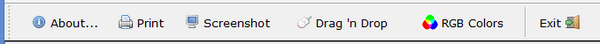

## TOOL-BAR

A Tool-Bar is a container of controls. It appears at the top of the window and usually shows Push-Buttons that the user can click. Since controls in Tool-Bars cannot be activated with the keyboard, the Tool-Bar should contain only shortcuts to commands that can be activated elsewhere with the keyboard. Usually, it replicates menu functions.

It’s good practice to populate a toolbar with controls that can act like function keys. In this way, the toolbar acts in a manner that is very similar to a menu bar. This simplifies other programming because you do not need to attempt to directly activate the controls on the toolbar. Controls that can act like function keys are buttons (push buttons, check boxes and radio buttons). Use the SELF-ACT style for buttons placed on a toolbar. For check boxes and radio buttons, use both the SELF-ACT and NOTIFY styles.
