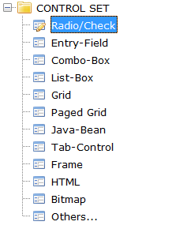

## TREE-VIEW

A Tree-View can represent hierarchical structures. It contains items that can have one or more children. Each item can contain graphics, text or both. Item text can also be editable.

### Colors and Fonts

Since each element of a Tree-View can be rendered with different colors and fonts and elements can be overlapped, priority rules are needed.

Colors are applied according to the following list of priorities. Items are listed from the most important to the least important:

- [Selection-Color](./Properties/Selection-Color), [Selection-Foreground-Color](./Properties/Selection-Foreground-Color), [Selection-Background-Color](./Properties/Selection-Background-Color)
- [Item-Color](./Properties/Item-Color), [Item-Foreground-Color](./Properties/Item-Foreground-Color), [Item-Background-Color](./Properties/Item-Background-Color)
- [Gradient-Color-1](./Properties/Gradient-Color-1), [Gradient-Color-2](./Properties/Gradient-Color-2)
- [Color](./Properties/Color), [Foreground-Color](./Properties/Foreground-Color), [Background-Color](./Properties/Background-Color)

Fonts are applied according to the following list of priorities. Items are listed from the most important to the least important:

- [Heading-Font](./Properties/Heading-Font)
- [Font](./Properties/Font)

### Filtering data

Tree-Views provide a integrated "find all" feature that is activated by pressing CTRL+F when the focus is on the Tree-View. When CTRL+F is pressed, the following panel is shown at the top of the Tree-View:

The text field on the right allows you to input the text you’re looking for. As you type text in the field, the Tree-View items that don’t include your text are removed. The items that include the text instead are made visible by expanding their parents if necessary (note that this action generates [MSG-TV-EXPANDING](./Events/MSG-TV-EXPANDING) events). The text is searched for without distinction between upper-case and lower-case letters (case insensitive).

The X button on the left allows you to close the panel. When the panel is closed, the Tree-View data is restored and all the elements are collapsed.

This feature can be disabled by setting the [Search-Panel](./Properties/Search-Panel) property to -1.

The search panel inherits the font from the Tree-View heading.

The layout of the search panel can be configured globally with the [iscobol.gui.search_panel_settings](../../../SDK-Users-Guide/Compiler-and-Runtime/Configuration/Configuration-Properties) configuration property or for specific Grid controls with the [SearchPanelSettings Class (com.iscobol.gui.server.SearchPanelSettings)](../../../Appendices/Internal-Objects/SearchPanelSettings-Class) class.

### Items expansion

The user can expand or collapse Tree-view items either with the keyboard or with the mouse:

- clicking on the button before the item text flips the item status (i.e. if the item was collapsed, it is expanded and viceversa),
- pressing the right arrow key expands the current item,
- pressing the left arrow key collapses the current item,
- pressing \* expands the current item and all its sub-items.
