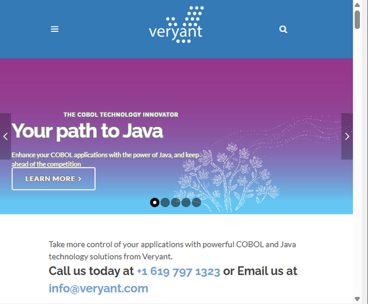

## WEB-BROWSER



A Web-Browser control allows you to embed a native web browser to the screen.

When the focus is on a Web-Browser some keys are trapped by the control and can’t be used to interrupt the ACCEPT of the screen. Two typical examples are the ESC key (caught by the browser as "stop loading" command) and the F5 key (caught by the browser as "refresh" command).

### Web-Browser implementations

The Web-Browser control is implemented through third party products that isCOBOL is able to interface. The Web-Browser implementation is controlled by the [iscobol.gui.webbrowser.class](../../../SDK-Users-Guide/Compiler-and-Runtime/Configuration/Configuration-Properties) configuration property.

#### SWTWebBrowser

This is the default implementation, based on Eclipse SWT (Standard Widget Toolkit).

The necessary library is distributed along with isCOBOL, so no particular action is required in order to use this browser. This browser is suitable for most needs, from browsing the internet to exploring disc folders. It’s also able to display PDF documents, like a normal web-browser. There are two cons:

- Java version 17 or higher is required to use this component,
- if the focus is captured by a field in the web page (e.g. Google’s search field), it’s not possible to give the focus to another input control of the Screen Section.

The SWTWebBrowser implementation maps the web browser components available in the operating system as follows:

- on Windows, the Microsoft Edge widget is used by default, but you can switch to the Internet Explorer ActiveX by setting the [iscobol.gui.webbrowser.class](../../../SDK-Users-Guide/Compiler-and-Runtime/Configuration/Configuration-Properties) configuration property as follows:

```ini
iscobol.gui.webbrowser.class=com.iscobol.browser.SWTWebBrowser?use_ie=true
```

- on Linux and MacOS, the WebKit open-source web browser engine is used. Note that WebKit may not be installed by default in your system; in such case you will have a Java exception like

```cobol
Exception in thread "SWT-Thread" org.eclipse.swt.SWTError: No more handles because there is no underlying browser available.
Please ensure that WebKit with its GTK 3.x/4.x bindings is installed.
```

   and you will need to install WebKit in the system in order to use the web-browser correctly.

#### JFXWebBrowser

This is an alternative implementation, based on the JavaFX’s [WebView](https://docs.oracle.com/javase/8/javafx/api/javafx/scene/web/WebView.html) control.

JavaFX was included in the Java Virtual Machine until version 8. Later Java versions might not include JavaFX; the presence of JavaFX in Java 11 and later depends on the distribution, for example Oracle JDK and OpenJDK don’t include it anymore, while Azul JDK still includes it. If your JDK doesn’t include JavaFX, you can download JavaFX as a separate add-on from [https://gluonhq.com/products/javafx](https://gluonhq.com/products/javafx).

The easiest way to make JavaFx libraries available for isCOBOL is by copying all the jars of the "lib" folder of the JavaFX SDK to the "jars" folder of the isCOBOL SDK.

In a thin client environment JavaFX is required client side.

The JavaFX implementation is not a real web-browser, it's a web-view component that interpretes HTML, DOM, CSS and JavaScript content. Therefore there are some limitations if you compare it with a real web-browser, for example:

- browsing disc folders is not supported
- non-html documents like PDFs, doc and xls are not shown
- *mailto:* and *ftp:* protocols are not supported

In addition, with this implementation the [MSG-WB-BEFORE-NAVIGATE](./Events/MSG-WB-BEFORE-NAVIGATE) and [MSG-WB-NAVIGATE-COMPLETE](./Events/MSG-WB-NAVIGATE-COMPLETE) events are never fired.

On the other hand, this is also the most lightweight browser implementation, so, if you’re OK with the above limitations, you should choose JavaFx.

#### JXWebBrowser

This is an alternative implementation, based on [JxBrowser](https://www.teamdev.com/jxbrowser).

JxBrowser is a commercial product and requires a valid license in order to work. The license code can be passed after the class name in the [iscobol.gui.webbrowser.class](../../../SDK-Users-Guide/Compiler-and-Runtime/Configuration/Configuration-Properties) setting as follows:

```ini
iscobol.gui.webbrowser.class=com.iscobol.browser.jx.JXWebBrowser?licenseKey=<your_license_code_here>
```

JxBrowser libraries must be downloaded separately and made available to isCOBOL.

You can download the latest JxBrowser at [https://www.teamdev.com/jxbrowser](https://www.teamdev.com/jxbrowser). Note that isCOBOL supports only JxBrowser version 7.8 or later.

The easiest way to make JxBrowser libraries available for isCOBOL is by copying all the jars of the "lib" folder of the JxBrowser’s zip archive to the "jars" folder of the isCOBOL SDK.

In a thin client environment JxBrowser is required client side.

This is the most powerful web-browser implementation available.
