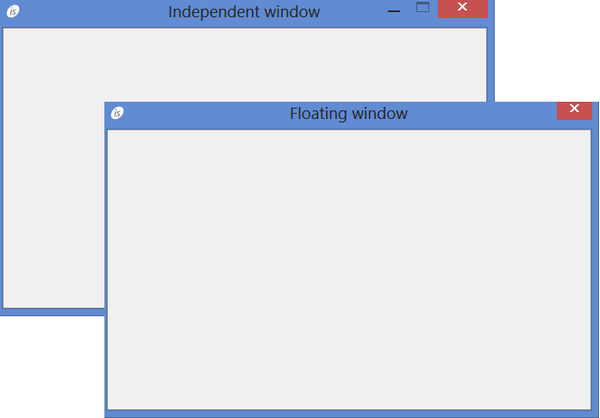

## WINDOW

Windows are containers of controls and can be resized or moved around.

Windows are created with the [DISPLAY](../../../Language-Reference/Procedure-Division-Statements/DISPLAY) Statement, Format 10.

There are six kinds of windows:

- INITIAL (or STANDARD): The main window of the COBOL application. There can be only one and therefore it’s usually used to store the application’s main screen. It appears as a button in the task bar. If you minimize it, all other windows of the same application are minimized.  If you click on the close button, a [MSG-CLOSE](./Events/MSG-CLOSE) event is generated and then the run unit terminates immediately as if a STOP RUN was issued.  Code the [MSG-CLOSE](./Events/MSG-CLOSE) event if you need to perform operations like closing files or freeing resources when the window is closed.
- INDEPENDENT: The most common type of window, typically used to store the screen of the COBOL application programs. It appears as a button in the task bar. If you click on the close button, a [CMD-CLOSE](./Events/CMD-CLOSE) event is generated only if the [System Menu](./Styles/System-Menu) style is set, otherwise nothing happens.
- FLOATING: A pop-up panel, bound to its parent window (which can be INDEPENDENT or INITIAL). By default, this kind of window is modal, which means the user cannot switch back to the parent window until the FLOATING window is closed. It does not appear as a button in the task bar and cannot be minimized, maximized or restored. If you click on the close button, a [CMD-CLOSE](./Events/CMD-CLOSE) event is only generated if the [System Menu](./Styles/System-Menu) style is set, otherwise nothing happens. When displayed in an MDI environment, they become children of the MDI-PARENT window.
- MDI-PARENT: A container of MDI-CHILD windows. It has the same characteristics as the INDEPENDENT window, but instead of storing a standard screen, it stores other windows, each one with its own screen. The child windows can be moved by the user inside the MDI-PARENT window area, but they never get outside of it. Only menu bars, status bars and tool bars can be displayed over a MDI-PARENT window, no other graphical control is allowed. Graphical controls should be displayed over the MDI-CHILD windows. If you click on the close button of MDI-PARENT window, a [MSG-CLOSE](./Events/MSG-CLOSE) event is generated and then the run unit terminates immediately as if a STOP RUN was issued.  Code the [MSG-CLOSE](./Events/MSG-CLOSE) event if you need to perform operations like closing files or freeing resources when the window is closed. If you click on the close button of a MDI-CHILD window, a [CMD-CLOSE](./Events/CMD-CLOSE) event is only generated if the [System Menu](./Styles/System-Menu) style is set, otherwise nothing happens. A MDI-CHILD window can contain other MDI-CHILD windows.
- NOTIFICATION: An undecorated pop-up window, shown for a given amount of seconds in a corner of the screen to notify the user.

The window position on the screen can be controlled by setting either the [Screen Line](./Properties/Screen-Line) and [[ Screen Col | Screen Column | Screen Pos | Screen Position ]](./Properties/Screen-Col-Screen-Column-Screen-Pos-Screen-Position) properties or by setting the [Line](./Properties/Line) and [[ Col | Column | Pos | Position ]](./Properties/Col-Column-Pos-Position) properties. If these properties are omitted, then a default positioning occurs, depending on the window type:

- INITIAL (or STANDARD) and MDI-PARENT windows are positioned in the top left corner of the screen.
- INDEPENDENT and FLOATING windows are centered over their underlying parent window, if any, otherwise they’re positioned in the top left corner of the screen.

The position of NOTIFICATION windows depends on the keywords BOTTOM, LEFT, RIGHT and TOP used in a Format 15 [DISPLAY](../../../Language-Reference/Procedure-Division-Statements/DISPLAY) statement. If none of these keywords was used, then the window is positioned in the top right corner of the screen.

#### Windows extension and customization through a hook class

The isCOBOL Framework allows you to customize the windows layout through an hook class that is automatically invoked before and after the display of the window.

See [WindowCreateHandler Interface (com.iscobol.rts.WindowCreateHandler)](../../../Appendices/Internal-Objects/WindowCreateHandler-Interface) for more details.
